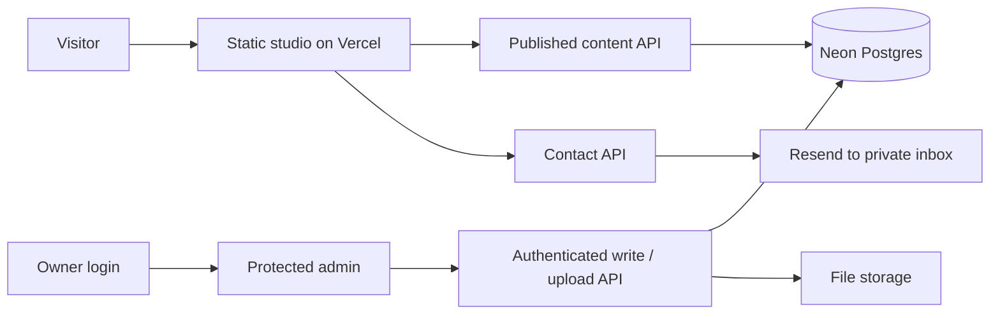

# Portfolio deployment proposal

Prepared 22 October 2026. This is a plan for discussion, not a record of a deployment or provisioned resources.

Current status, 22 October 2026: the studio, Neon-backed CMS, owner authentication and private Blob uploads have now been implemented and deployed to https://after-hours-portfolio-virid.vercel.app/. Separate production/development resources are provisioned. Resend is connected through a Production secret. The owner confirmed successful sign-in through the emailed password setup and actual Contact-test arrival in Gmail. See `CMS_SETUP.md`, `qa/cms/CMS_VERIFICATION.md` and `qa/deployment/CMS_DEPLOYMENT_VERIFICATION.md` for the current state. The original static release is recorded in `qa/deployment/DEPLOYMENT_VERIFICATION.md`.

## Original proposal

The remaining text preserves the pre-implementation assessment. Its statements about unprovisioned services describe that earlier point in time.

## Current repository

- The frontend is static HTML/CSS/native JavaScript; no React/Next migration or frontend build is needed.
- The approved cat and parrot now run in the main studio. Their original room videos remain unchanged.
- Projects, About, Journey, Resume and Notes use shared repository/adaptor methods, currently backed by fixtures. Both miniature monitors and expanded content reuse those records.
- `api/contact.js` is a prepared Vercel Node handler calling Resend. Live delivery is disabled until server settings and abuse controls are configured.
- Admin login/dashboard, database reads/writes, publishing and file uploads have not been implemented or provisioned. Hosting alone will not create these features.

## Recommended setup

| Piece | Proposal | Purpose |
| --- | --- | --- |
| Frontend | Vercel, keeping this static website | Room videos, interactions, published portfolio content |
| Backend | Node.js Vercel Functions in the same project | Published-content API, protected admin operations, uploads and contact |
| Database | Neon Postgres | Content, metadata, stable IDs, ordering, publication state |
| Uploaded files | Vercel Blob | Project/Journey photos and replacement public resume PDFs |
| Contact delivery | Existing Resend adapter | Send form messages to the configured private inbox |
| Administration | A protected `/admin` area in the same site | One owner account; edit all sections and publish changes |

Vercel supports Node functions in a root `api/` directory. Its current guidance favors grouping related API routes rather than creating a separate function for every small endpoint. We can keep this site's plain JavaScript and existing contact handler while adding the content API; a separate always-running Render server is not required for these request/response operations. [Vercel Node runtime](https://vercel.com/docs/functions/runtimes/node-js)

## What belongs in the database

Store descriptions, dates, links, alt text, display order and draft/published state in Postgres. Store image/PDF files in file storage and save their URLs/metadata in Postgres. The room animation files can remain versioned static assets; they do not need to be uploaded or stored inside database rows.

The content model should cover Projects and their case studies, personal About/social links, Journey milestones, Resume chapters/download, Notes, media and public site settings. Keep the existing shared adapters so the miniature and expanded interfaces cannot diverge.

Use one-owner authentication with server-verified sessions and an owner allowlist. Enforce authorization on every write, deletion and upload-token request. A hidden admin URL or client-side login check is not sufficient. There is no need for public registrations or a role-management system for this portfolio.

## Idle behavior and free-plan fit

- Neon Free currently includes 1 GB Postgres storage per project and 100 CU-hours/project. Compute sleeps after five idle minutes and **reactivates automatically on the next query**. This does not require manually unpausing an idle project or scheduling keep-alive requests. Exhausting compute/transfer quotas can still suspend service until reset/upgrade. Cache published content to reduce database traffic and keep the studio quick. [Neon plans](https://neon.com/docs/introduction/plans), [Scale to Zero](https://neon.com/docs/introduction/scale-to-zero)
- Vercel Blob Hobby currently includes 1 GB storage and 10 GB monthly Blob transfer, with operation limits. That is a reasonable starting allowance for a small photo collection, not an unlimited service. [Blob pricing](https://vercel.com/docs/vercel-blob/usage-and-pricing)
- Resend Free currently allows 3,000 emails/month and 100/day. Configure an appropriate verified sender and keep the receiving inbox/API key server-side. A custom domain, if chosen, has its own registration cost. [Resend pricing](https://resend.com/pricing)
- Vercel Hobby is for personal, non-commercial use and has usage limits. These free tiers are a plausible starting point for this personal portfolio, subject to the actual traffic and account quotas. [Hobby plan](https://vercel.com/docs/plans/hobby)

The three current room videos total about 3.62 MB. Initial hosting can serve them directly as static files. We should not move them through API functions or query the database per animation frame.

## Implementation and launch order

1. **Package the current studio for a preview.** Serve runtime files only; exclude QA recordings, tests, `.npm-cache`, temporary files and local tooling. Keep API secrets in deployment environment variables. Check page refresh/deep links and media paths on the actual preview URL.
2. **Build the small CMS backend and owner dashboard.** Add schema/migrations, published reads, authenticated editing, draft/publish, ordering and validation for all sections. Retain the current public interaction design.
3. **Connect Neon and file storage.** Keep database credentials server-side, choose a nearby compatible Functions/database region, authorize uploads, and store file metadata/URLs with the content. Export/backup content so changing providers stays possible.
4. **Connect contact delivery.** Configure sender/inbox/origin, add a durable or platform-supported rate limit and bot protection, then test accepted delivery and failures. The current honeypot/origin checks alone are not a complete abuse-control strategy.
5. **Verify a complete preview workflow.** Owner logs in, edits a project, uploads an image, publishes, and sees the same record in the miniature and expanded interface; drafts remain private. Verify Journey/Resume/About/Notes editing and contact delivery too.
6. **Promote after review.** Use separate preview/development data and production secrets so preview edits cannot accidentally modify the public portfolio.

We can share the static studio preview before the CMS is ready, with the current placeholder content and an honest unconfigured Contact state. The full editable portfolio requires steps 2–5. No database, Blob store, mail account, remote push or deployment has been created by this planning step.
