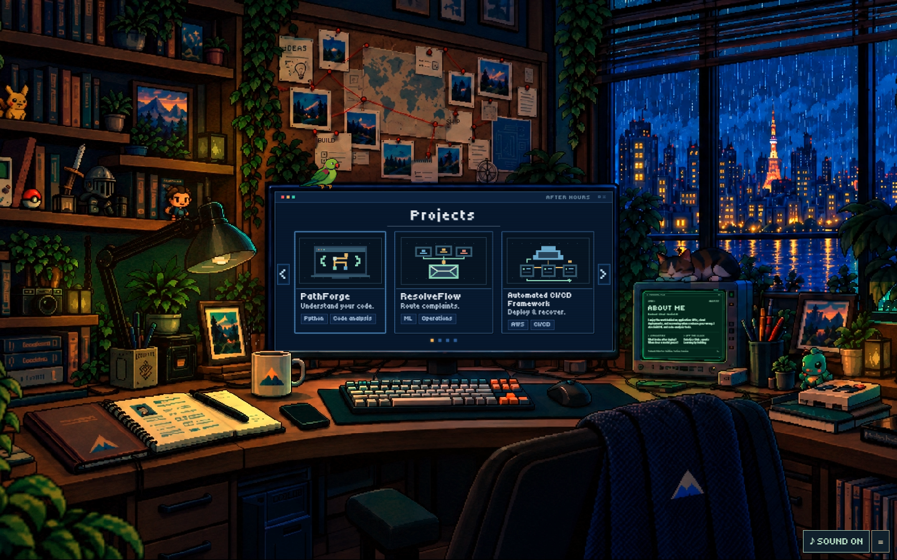
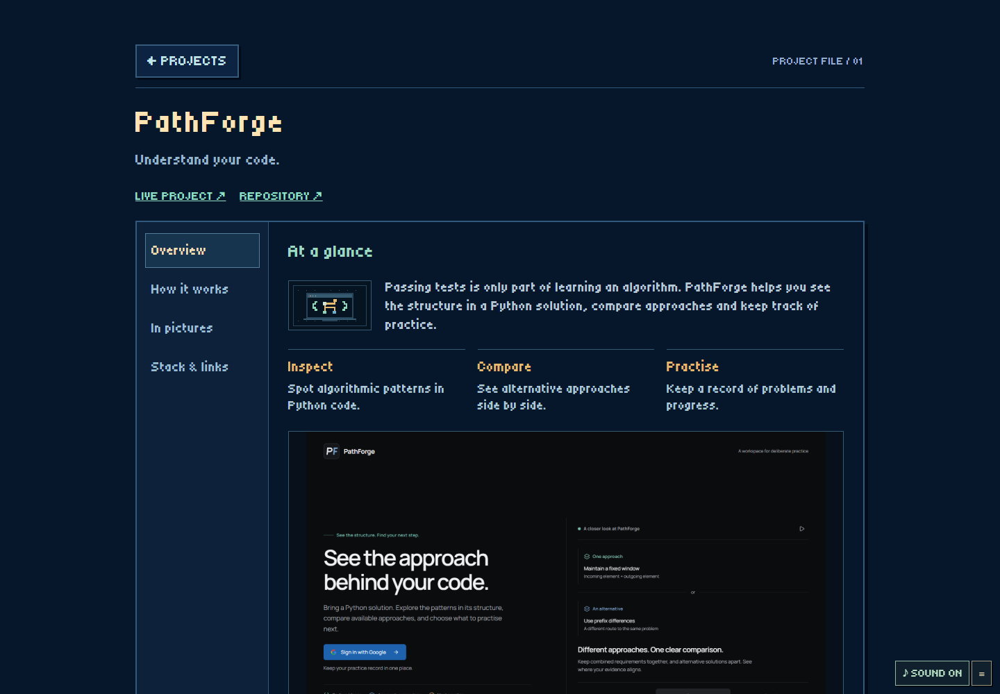
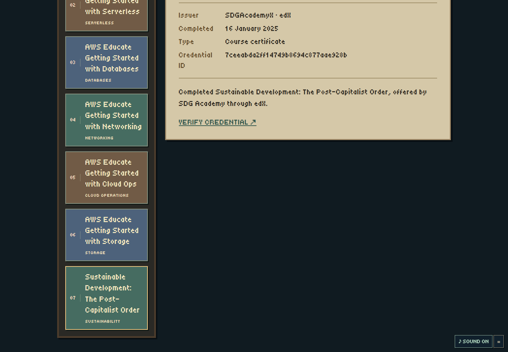

<h1 align="center">After Hours</h1>

<p align="center">
  <strong>My portfolio, inside a pixel-art studio.</strong><br>
  Backend · Cloud · Applied AI
</p>

<p align="center">
  <a href="https://after-hours-portfolio-virid.vercel.app/">
    
  </a>
  <a href="https://github.com/vedanshmehrotra">
    
  </a>
  <a href="https://www.linkedin.com/in/vedansh-mehrotra-05b41331b/">
    
  </a>
</p>

## The idea

I wanted my portfolio to feel like a place you can explore.

The monitor opens my projects. The green CRT introduces me. A pinned board follows my professional journey, a journal holds my resume, and the phone lets you leave a message.

Behind the room is a small full-stack application: an owner dashboard, PostgreSQL content storage, private file uploads and email delivery. I can update the portfolio without editing the website's code.

## 📸 The studio



The scene keeps its original room artwork and ambient videos. Live monitor content, localized animal sprites and interactions sit on top of it.

<p align="center">
  
  
</p>

## What you can explore

| Object | Inside |
| --- | --- |
| Main monitor | **Projects** — PathForge, ResolveFlow, Automated CI/CD Framework and PlanEase. Short explanations, process steps, screenshots and stack links. |
| Green CRT | **About me** — interests, current direction and profile links. |
| Pinned board | **Journey** — education, internships, leadership and academic recognition, connected by a red thread. |
| Open journal | **Resume** — readable chapters and the original PDF download. |
| Bookshelf | **Certifications & learning** — AWS Educate badges, course certificates and verification links. |
| Phone | **Contact** — a message form with actual inbox delivery and errors inside the app. |

The miniature monitor and expanded project interface use the **same published content**. Changing a project in the dashboard updates both views.

## Small details that matter

- A continuous camera moves toward each object, with short pixel speed lines during the zoom.
- The lamp plays the supplied lighting transition; switching it off is immediate. This branch also lights it automatically after **3.5 seconds of visible room time**, once loading finishes. Manual switching takes priority.
- A small parrot breathes, blinks and occasionally preens at **8 FPS**. The cat reacts to the lamp and petting through localized overlays.
- Indoor rain, object clicks, paper sounds and a cat purr have separate ambience/effect volume controls. Sound defaults on, starts after a user interaction and remembers a mute preference.
- Pixel cursors change for clickable objects, petting, dragging and genuine waiting. Text inputs retain the normal text cursor.
- Keyboard navigation, visible focus, Escape / Back, deep links, mobile shortcuts and reduced-motion behavior are supported.

## ⚙️ Under the hood

```text
Public studio                      Owner dashboard
      │                                  │
      │ GET /api/content                 │ authenticated edits
      ▼                                  ▼
Published snapshot              Private draft → Publish
      └─────────────────┬────────────────┘
                        ▼
                 Neon PostgreSQL

Images / PDFs → private Vercel Blob → public only when published
Contact form  → validated API → rate limits → Resend → owner inbox
```

The frontend uses **HTML, CSS and JavaScript** with the browser's Web Animations API. One room coordinate system keeps the video, monitor overlays, hotspots and camera targets aligned across viewport sizes.

The backend runs as five Vercel Node functions. Better Auth handles the owner session; public sign-up is disabled. Drafts stay private, stale edits are rejected, and uploads become publicly readable only when published content references them.

Journey grows through the dashboard: add a chapter, optional photo, story and display order, then save and publish. The current limit is **100 milestones**, with **six pins per board page**. Missing photos use small pixel document cards.

## 🛠️ Tech stack

<p>
  
  
  
  
</p>

<p>
  
  
  
  
  
  
</p>

## 🚀 Running locally

Requirements: Node.js 22 or later, Python 3 for the static preview, and Google Chrome for the browser tests.

```bash
git clone https://github.com/vedanshmehrotra/Potfolio-Site.git
cd Potfolio-Site
npm ci
npm run dev
```

Open **http://127.0.0.1:4173/**. This preview uses sample content and does not connect to the private database or deliver messages.

For the full CMS, configure a separate development database, auth settings and private media store in `.env.local`, following [CMS setup](CMS_SETUP.md). Then run:

```bash
npm run db:migrate
npm run dev:cms
```

Open **http://127.0.0.1:4180/**; the owner editor is at **/admin**. Never reuse production data for integration tests. Credentials belong in local environment files or Vercel settings.

## 🧪 Verification

```bash
npm run test:unit
npm test
```

The tests cover content validation, draft isolation, contact validation, video hashes, camera behavior, navigation, audio, localized animal animations, mobile layouts and accessibility interactions. Playwright uses the installed Chrome browser.

Real CMS checks are separate from the static frontend tests. [CMS setup](CMS_SETUP.md) explains their development-only environment requirements. [Journey and lamp verification](qa/journey-release/VERIFICATION.md) records the latest checks; earlier project presentation and production evidence is in [the content report](qa/content/PRESENTATION_VERIFICATION.md).

## 📁 Repository layout

```text
Potfolio-Site/
├── index.html, app.js              # Studio, camera and monitor interfaces
├── sections.js, sections.css       # Journey, journal, shelf and contact
├── audio.js, cursor.js             # Sound and contextual pixel cursors
├── cat.js, parrot.js               # Localized animal sprites
├── assets/                        # Room images, fonts, sprites and project media
├── admin/                         # Owner content editor
├── api/, server/                  # Vercel entry points and backend services
├── db/                            # Versioned database migrations
├── content/                       # Reviewed portfolio content bundle
├── scripts/                       # Build, maintenance and verification tools
├── tests/                         # Node and Playwright checks
└── docs/screenshots/              # README browser captures
```

## Notes

The live portfolio is on Vercel. The latest Journey refinement and automatic lamp behavior are prepared in this branch; the custom domain is pending GitHub Education approval.

- [Implementation notes](STUDIO_IMPLEMENTATION.md) — coordinate mapping, camera, media and review workflow.
- [CMS setup](CMS_SETUP.md) — database, owner login, publishing, uploads and email.
- [Interaction notes](STUDIO_INTERACTION_NOTES.md) — approved cursor, lamp, sound and Journey behavior.
- [Sound credits](assets/audio/CREDITS.md) · [Tiny5 font license](assets/OFL-Tiny5.txt).
